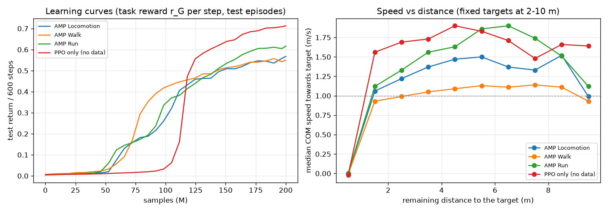

# Target Location: results of the 4 runs (27 Nov 2026)

Configs: `configs/location/` (see its README). 200 M samples each, `rl/train.py`, one A5000 per run
(lab machines gelinotte, mouette, rouloul, faisan), 1 h 40 to 2 h 40.
Evaluation: `validation/eval_location.py` (full output: `outputs/rl/<run>/eval.txt`).
Videos: `validation/video_location.py` (`outputs/rl/<run>/videos/`).

Left: learning curves (task reward r_G per step on the test episodes). Right: median speed of the
COM towards the target vs the remaining distance (fixed targets at 2 to 10 m). Figure made by
`make_figure.py`.

## Normalized task return (Table 1 protocol: 32 episodes of 20 s, mean r_G per step)

| Run | Return | Falls | Article |
|---|---|---|---|
| AMP Locomotion | 0.536 ± 0.087 | 0/32 | 0.63 (Table 1) |
| AMP Walk | 0.549 ± 0.094 | 0/32 | – |
| AMP Run | 0.610 ± 0.137 | 1/32 | – |
| PPO only (no data) | 0.716 ± 0.067 | 0/32 | ~0.6 (Fig. 5) |

No episode ends with the target more than 15 m away.

## Fixed targets (12 episodes per distance, reached = within 0.5 m)

| Run | 2 m | 4 m | 6 m | 8 m | 10 m | Median time to reach 10 m |
|---|---|---|---|---|---|---|
| AMP Locomotion | 12/12 | 12/12 | 12/12 | 12/12 | 11/12 | 8.4 s |
| AMP Walk | 12/12 | 12/12 | 12/12 | 12/12 | 11/12 | 9.4 s |
| AMP Run | 11/12 | 12/12 | 12/12 | 12/12 | 12/12 | 6.4 s |
| PPO only | 11/12 | 12/12 | 12/12 | 12/12 | 11/12 | 5.2 s |

Median speed towards the target (m/s), by remaining distance:

| Run | 1-2 m | 3-4 m | 5-6 m | 7-8 m |
|---|---|---|---|---|
| AMP Locomotion | 1.06 | 1.37 | 1.50 | 1.33 |
| AMP Walk | 0.93 | 1.05 | 1.13 | 1.14 |
| AMP Run | 1.12 | 1.56 | 1.86 | 1.74 |
| PPO only | 1.56 | 1.73 | 1.83 | 1.48 |

## Reading

- **The task is learned by all 4 runs**: 97-98 % of the targets reached, no episode lost by moving away.
- **The style follows the dataset**: Walk stays at ~1.1 m/s (walking speed), Run goes up to
  ~1.9 m/s. Locomotion is in between and speeds up with distance (1.06 → 1.50 m/s): the article's
  "walk when near, run when far" behavior appears, but in a milder form (the median stays below a
  real run).
- **AMP Locomotion is below the article** (0.54 vs 0.63). The learning curve is still rising at
  200 M samples (0.50 → 0.57 over the last 50 M), so more samples would probably narrow the gap.
- **PPO alone gets the best task return** (0.72, above the article's ~0.6): without a style
  reward it optimizes r_G only, and moves fast from the very first meters. In the videos its
  posture is hunched and unnatural, while the AMP characters stay upright with mocap-like gaits:
  this matches the article's point (similar task performance, very different motion quality).
- **Neck (frozen neck in the Run clips)**: the style reward of AMP Run does not collapse
  (0.50 → 0.35 at the end of training, vs ~0.05 before the fix): the series 6 fix (normalizer
  on agent + mocap) holds on this task too.
- Close to the target (0-1 m) the median speed is 0: the characters stop on the target, as
  r_vel = 1 within 0.5 m allows.

## Videos

For each run, in `outputs/rl/<run>/videos/`:

- `schedule.mp4`: the normal target schedule (new target every 5 to 10 s, at 0 to 10 m);
- `scripted.mp4`: 8 m at 45° to the left, then at 10 s 2 m to the right, then at 14 s 6 m behind.

| Run | Final distance, schedule | Final distance, scripted |
|---|---|---|
| AMP Locomotion | 0.83 m | 1.71 m |
| AMP Walk | 0.76 m | 1.64 m |
| AMP Run | 0.96 m | 0.06 m |
| PPO only | 0.34 m | 0.19 m |

(In the scripted video, the last target appears at 14 s, 6 m behind: Walk and Locomotion have
not quite reached it at 20 s, Run and PPO have.)
